# DocuWare Connector

[DocuWare](https://start.docuware.com/) bietet cloudbasierte Software für
Dokumentenmanagement und Workflow-Automatisierung. Damit lassen sich beliebige
Geschäftsdokumente auf revisionssichere Weise digitalisieren, archivieren und
verarbeiten, um die Kernprozesse Ihres Unternehmens zu optimieren.

**DocuWare-Organisation**\
Ein *DocuWare-Organisation* ist der oberste Mandant in DocuWare. Er stellt eine
isolierte Umgebung dar, die Benutzer, Rollen, Konfigurationen und alle
Dokumenten-Repositorys der Organisation enthält.

**File Cabinet**\
Ein *File Cabinet* ist ein Dokumentenarchiv innerhalb einer Organisation. Es
speichert Dokumente zusammen mit ihren indizierten Metadaten (Felder wie
Rechnungsnummer, Datum, Lieferant) und ermöglicht das Suchen, Speichern und
Abrufen von Dokumenten.

**Funktionsumfang des Konnektors**\
Mit diesem Konnektor können Sie **mehrere DocuWare-Organisationen**, die jeweils
**mehrere Aktenschränke** enthalten, in einer einzigen Konfiguration verbinden.
Dies ermöglicht den Zugriff auf und die Verwaltung von Dokumenten über mehrere
DocuWare-Umgebungen hinweg. Er ermöglicht die effiziente Integration von
DocuWare-Funktionalitäten in Ihre **Axon Ivy-Prozessanwendungen**.

Dieser Konnektor minimiert Ihren Integrationsaufwand durch:

- Einsatz von REST-Webservice-Technologien
- Eine oder mehrere DocuWare-Organisationen abrufen
- Dateischränke abrufen
- Bereitstellung einer grafischen Benutzeroberfläche zum Anzeigen und Bearbeiten
  der Dokumenteigenschaften der Standard-DocuWare-Instanz
- Bereitstellung von Konfigurationen zum Testen verschiedener
  Authentifizierungsmethoden

## Demo
### DocuWare Basic Demo: Organisationen, Aktenschränke und Dokumente abrufen

1. Starten Sie den DocuWare-Demoprozess:

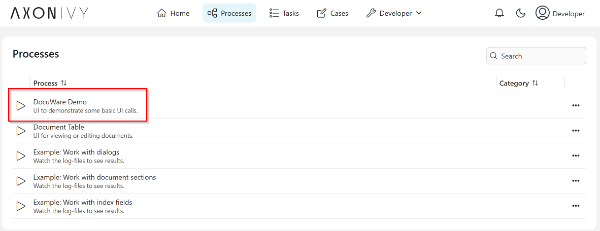

Die DocuWare-Demo bietet eine grafische Benutzeroberfläche zum Testen
verschiedener DocuWare-Konfigurationen. Um alle Demo-Funktionen nutzen zu
können, müssen mehrere Konfigurationen mit unterschiedlichen Berechtigungstypen
in der Datei „ `variables.yaml“` bereitgestellt werden. **Für eine einfache Demo
(basierend auf Benutzername und Passwort): – geben Sie einfach eine
„defaultConfig“ an**.

#### Organisationen abrufen
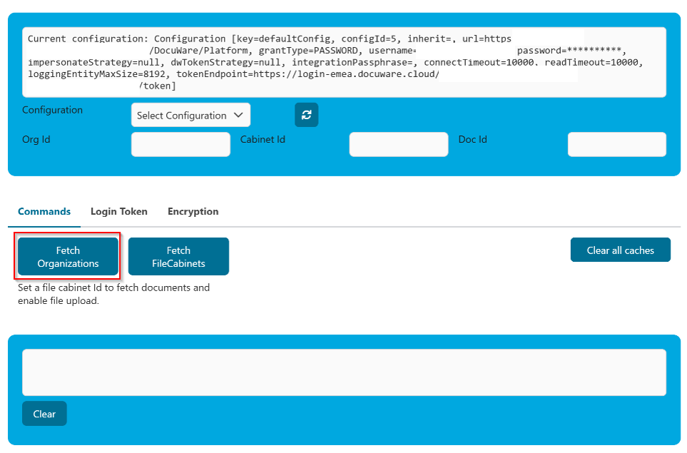

Wenn alles geklappt hat, wird im Textfeld unterhalb der Schaltflächen die
Antwort „ `: Status: OK` “ angezeigt. Das könnte etwa so aussehen:
```
Antwort: Status: OK

Header
=======
Content-Type: application/xml; charset=utf-8
Date: Fri, 06 Mar 2026 03:57:13 GMT
Cache-Control: max-age=0, private
Set-Cookie: dwingressplatform=1772769434.007.32.96427|a8466521666073443d68d0f15f64584f; Path=/; Secure; HttpOnly
Transfer-Encoding: chunked
Vary: Cookie,Accept,Accept-Encoding
Strict-Transport-Security: max-age=31536000; includeSubDomains; preload
Server-Timing: proxy-start;dur=1.5
```
#### Dateischränke abrufen
Wenn Sie auf „Dateischränke abrufen“ klicken, werden mehrere zusätzliche
Schaltflächen (Funktionen) verfügbar.

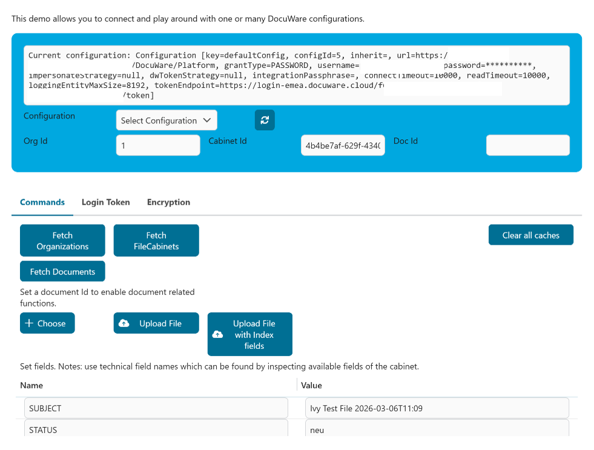

Insbesondere erhalten Sie am Ende Ihrer Protokolldatei eine Liste der
verfügbaren Dateischränke. Diese könnte etwa so aussehen:

```
Aktenschränke:
Anzahl: 5
ID: 4b4be7af-629f-4340-82cb-126d249d2b95 – „Awesome Filecabinet“
ID: 90b4f666-b79f-4d26-97f7-7786d8fbe4c2 – „TEST-Aktenordner“
ID: 94532ab8-a22f-4b70-a15d-ba44d916bd45 – „Archiv-Aktenordner“
Id: wdss996-b61c-4b4b-88fd-e506a58156278 – „Src“
Id: 43sfsdfb137-c5a8-4ab-ae73-715e7c360f – „Nicht wichtig“
```

Wählen Sie einen Aktenschrank aus, den Sie genauer untersuchen möchten, und
kopieren Sie dessen ID in die Benutzeroberfläche.

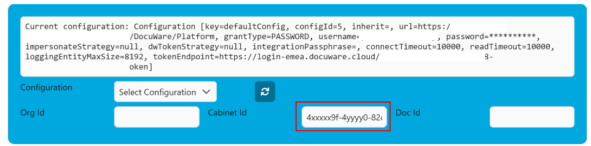

#### Dokumente abrufen und herunterladen
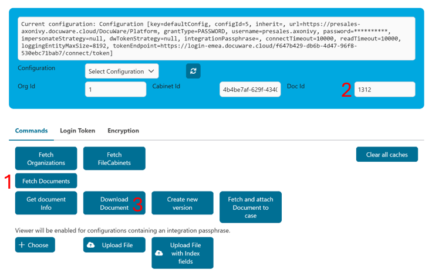

Um ein Dokument abzurufen und herunterzuladen, klicken Sie auf „Dokumente
abrufen“ (1), um eine Liste der verfügbaren Dokumente im Protokoll-Viewer
anzuzeigen. Sie erhalten eine Liste, die wie folgt aussieht:

```
Dokumente:
Anzahl: 4
ID: 11 – „Hello World“
ID: 10 – „Bla“
ID: 7 – „Umlaut.äöüÄÖÜß“
ID: 6 – „Bla“
```
Merken Sie sich die ID des Dokuments, das Sie näher prüfen möchten, und geben
Sie diese in die Benutzeroberfläche (2) ein. Mit „Dokument herunterladen“ (3)
können Sie dann das zu dieser ID gehörende Dokument herunterladen.

#### Weitere Funktionen
- Unter Verwendung verschiedener Konfigurationen, d. h. für verschiedene
  Förderarten
- Dokumentfelder abrufen
- Ein Dokument herunterladen
- Eine neue Version eines Dokuments erstellen
- Ein Dokument an einen Ivy-Fall anhängen
- Ein Dokument hochladen
- Hochladen eines Dokuments mit Indexfeldern
- Anzeigen von Dateien mit dem eingebetteten DocuWare-Viewer (sofern in der
  Konfiguration die „ `“-Passphrase` festgelegt ist und Ihre
  DocuWare-Installation die Einbettung in einen Frame zulässt – überprüfen Sie
  die Inhaltssicherheitsrichtlinie Ihres DocuWare-Systems!)
- Verschlüsselung und Entschlüsselung von Parametern für die Einbettung

### Zweites Demo: Dokumenttabelle

Stellen Sie sicher, dass Sie eine File-Cabinet-ID in der Datei „variables.yaml“
unter `` konfiguriert haben. Denken Sie daran, dass Sie verfügbare File Cabinets
mithilfe des ersten Demo-Prozesses abrufen können (siehe oben).

```
# Von der Demo verwendete Variablen.
  docuwareWorkflow:
    fileCabinetId: ""
```

Starten Sie den Prozess unter **Document Table**, um einen einfachen Viewer zu
erhalten, der zeigt, wie man Dokumente hinzufügt, ändert, anzeigt und löscht.

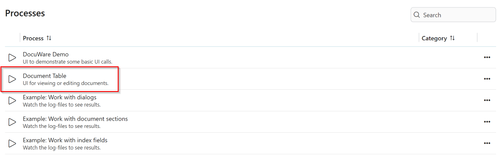

Es öffnet sich eine benutzerfreundliche Oberfläche:

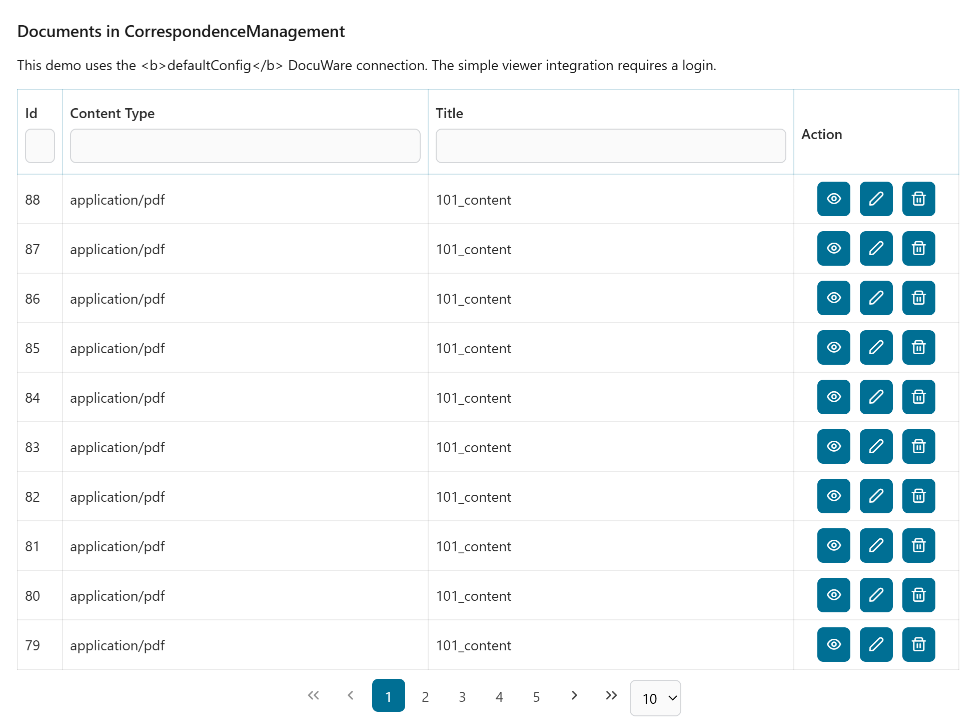

**Dokumentvorschau**

Beachten Sie, dass für die Vorschau von Dokumenten möglicherweise eine
zusätzliche Konfiguration der Content Security Policy (CSP) Ihrer
DocuWare-Installation erforderlich ist, um die Einbettung von DocuWare-Frames in
Ihre Axon Ivy-Frames zu ermöglichen.

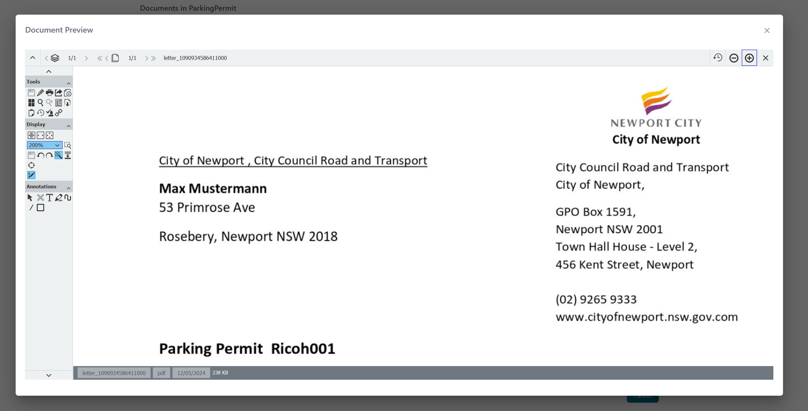

**Dokumenteneigenschaften bearbeiten** Dokumenteneigenschaften ändern,
einschließlich Metadaten und benutzerdefinierter Felder.

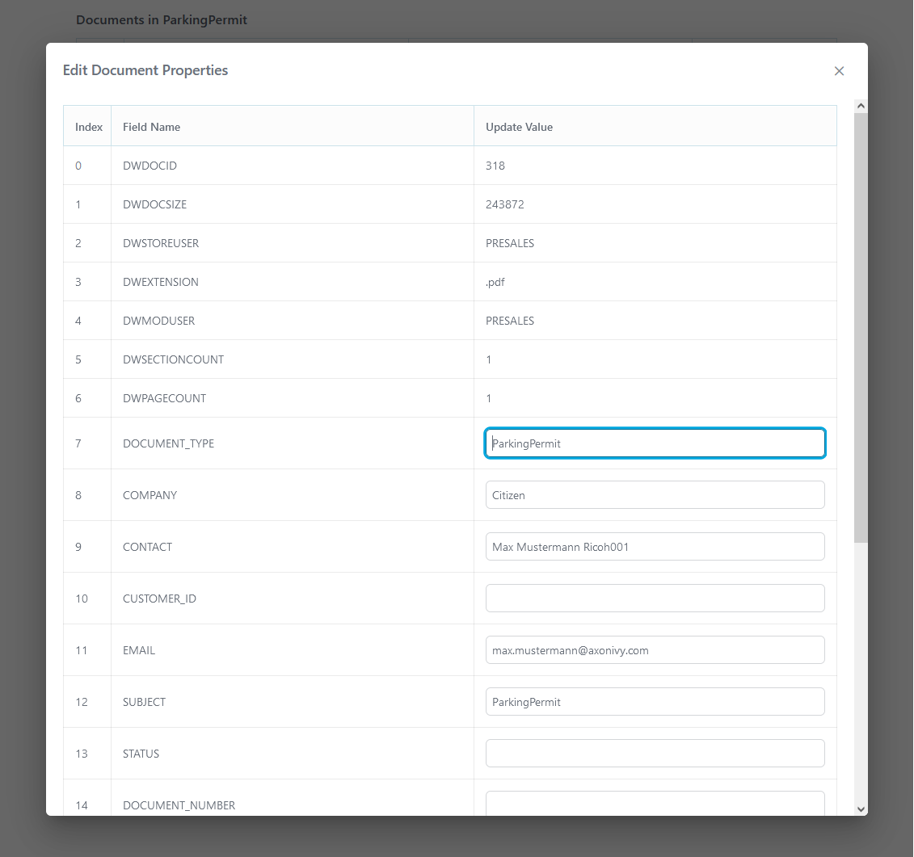

**Dokumentenlöschung** Löschen Sie Dokumente aus dem Aktenschrank.

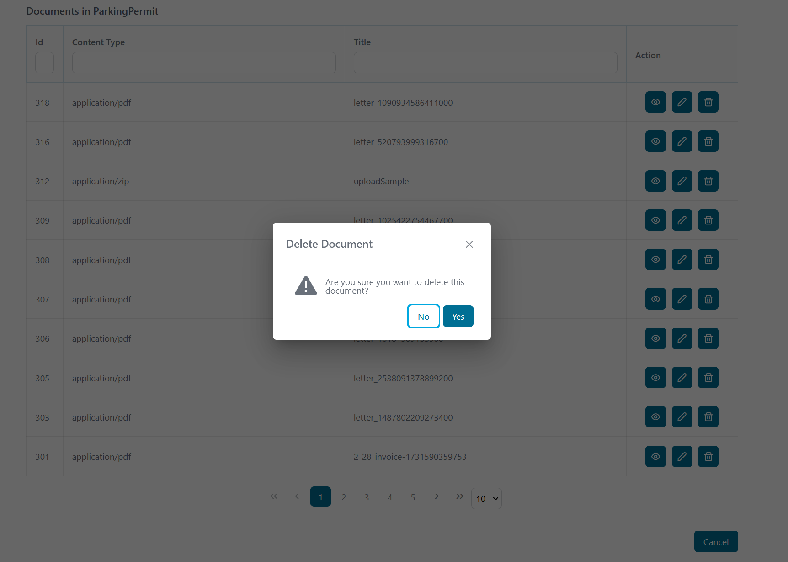

### Stamp-Demo

Starten Sie die „ **Stamp“ unter** über den Link zum Prozessstart.

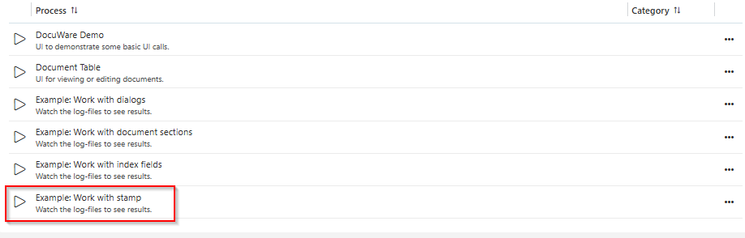

1. Die Demo ruft die Stempelvorlagen ab, die das aktuelle Konto verwenden darf.
   Das Ergebnis wird im Protokoll ausgegeben, zum Beispiel:

```
***DocuWareDemo-Stamp – Gefundene Stempel: 3
Stempel-ID=xxxx-xxxx-xxxx-xxxx-xxxxxxxxxxxx, Name=ABC-AP1
Stempel-ID=yyyy-yyyy-yyyy-yyyy-yyyyyyyyyyyy, Name=ABC-AP2
Stempel-ID=zzzz-zzzz-zzzz-zzzz-zzzzzzzzzzzz, Name=ABC-AP3
```

2. In der Demo wird ein Dokument hochgeladen und mit der ersten Stempelvorlage
   versehen.
3. Schließlich wird das abgestempelte Dokument heruntergeladen und dem Ivy-Fall
   beigefügt.

   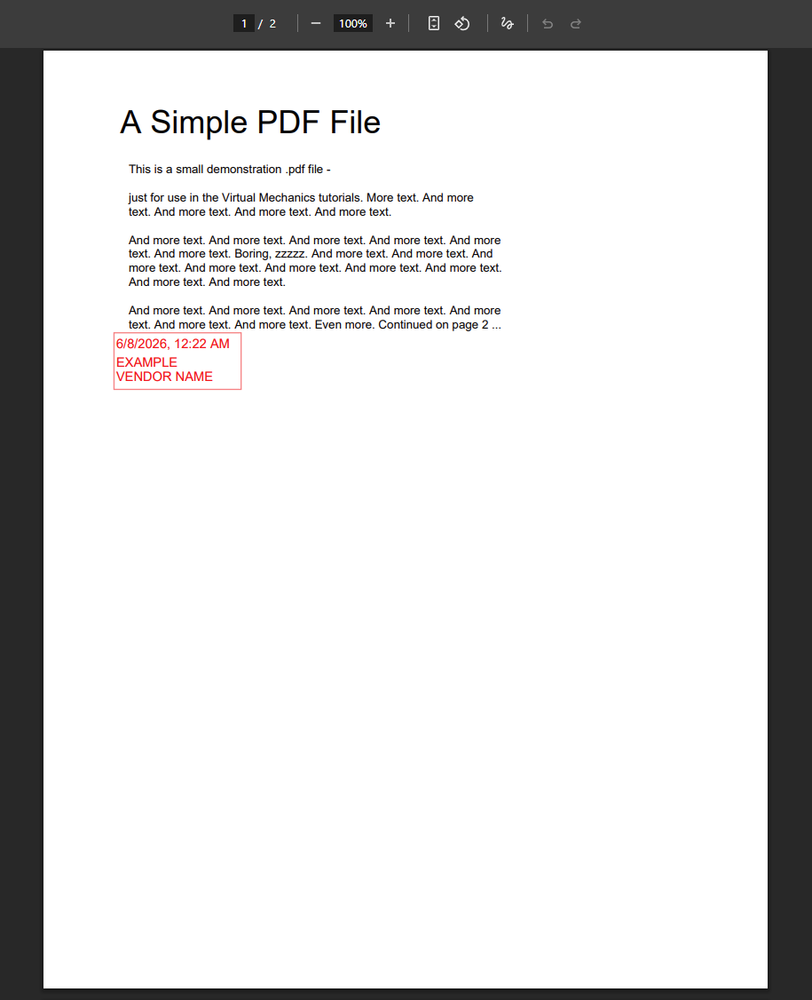

### Weitere Demos

Andere Startprozesse zeigen Beispiele für die Verwendung von DocuWare.


## Setup
Bitte kopieren Sie `variables.yaml` in Ihr Projekt.

```
@variables.yaml@
```

Mindestens die URL „ `“ (`), der Benutzername „ `“ (` ) und das Passwort „ `“ (`
) müssen angegeben werden.

### `configId`

Ein beliebiger Wert, der diese Version der Konfiguration identifiziert.

### `inherit`

Jeder Wert, der in der aktuellen Konfiguration nicht vorhanden, leer oder
unbestimmt ist, wird in der durch diese Variable referenzierten Konfiguration
nachgeschlagen. Die Suche erfolgt rekursiv.

### `grantType`

Dies ist der Grant-Typ für Ihre Konfiguration. Mögliche Werte sind „ `“,
„password“`, „ `“, „trusted“` und „ `“ dwtoken`.

#### `Passwort`

Die Berechtigungsart „ `“ (Passwort:` ) verwendet einen festen Benutzernamen „
`“ (` ) und das Passwort „ `“ (` ), um eine Verbindung zu Ihrer DocuWare-Instanz
herzustellen. Alle Vorgänge werden über dieses Benutzerkonto ausgeführt, und in
allen Verlaufseinträgen wird dieser Benutzer angezeigt. Es handelt sich um eine
einfache Konfiguration, bei der ein technischer Benutzer „ _“ (_ ) verwendet
wird, um eine Verbindung zu einer DocuWare-Instanz in der Cloud oder vor Ort
herzustellen.

#### `vertrauenswürdig`

Der Grant-Typ „ `“ für den vertrauenswürdigen Benutzer` verwendet den
Benutzernamen `, den Benutzernamen` und das Passwort `sowie die E-Mail-Adresse`,
um sich als vertrauenswürdiger Benutzer bei Ihrer DocuWare-Instanz anzumelden.
Derzeit unterstützt DocuWare vertrauenswürdige Benutzer nur für
On-Premise-Installationen. Der vertrauenswürdige Benutzer wird nicht direkt
verwendet, sondern schlüpft in die Rolle eines anderen Benutzers. Welcher
Benutzer nachahmt werden soll, kann in der globalen Variablen „
`impersonateUser“ unter` konfiguriert werden.

`„impersonateUser“` implementiert eine spezielle Syntax, um festzulegen, welcher
Benutzer für Zugriffe durch anonyme Ivy-Benutzer, Zugriffe durch den
Ivy-Systembenutzer und Zugriffe durch andere Ivy-Benutzer verwendet werden soll:

- Verwenden Sie in allen Fällen denselben Benutzernamen.
- Verwende feste Benutzernamen für anonyme und Systembenutzer, für alle anderen
  jedoch den Benutzernamen „Ivy“.
- Legen Sie den Benutzernamen in der Benutzersitzung fest, bevor Sie Aufrufe
  tätigen, und verwenden Sie diesen Namen.

Weitere Informationen finden Sie in der Datei „ `variables.yaml“ unter`.

#### `dwtoken`

Das Token wird unter Verwendung eines vorhandenen Tokens von DocuWare generiert.
Hinweis: Dieser Anwendungsfall wird wahrscheinlich nicht vollständig
unterstützt. Welches Token verwendet werden soll, wird unter `dwToken`
konfiguriert. Derzeit kann das vorhandene Token nur aus der Sitzung geladen
werden.

### Weitere Konfigurationsvariablen

Weitere Konfigurationsvariablen sind direkt in den vom Connector unterstützten
Variablen dokumentiert. Bitte lesen Sie dort die Beschreibung und kopieren Sie
sie in Ihr Projekt, falls Sie diese verwenden, damit sie im Engine-Cockpit für
Ihre Anwendung sichtbar ist.

```
@variables.yaml@
```

### Verwendung einer einzelnen DocuWare-Instanz

Wenn Sie nur mit einer Instanz arbeiten, sollten Sie diese „ `defaultConfig` “
nennen; sie wird dann automatisch und ohne weitere Maßnahmen verwendet.

### Gleichzeitige Nutzung mehrerer DocuWare-Instanzen

Wenn Sie mit mehreren Instanzen arbeiten, muss jeder Aufruf wissen, welche
Instanz verwendet werden soll. Daher bieten alle instanzspezifischen
Unterprozesse, die von diesem Konnektor bereitgestellt werden, einen
zusätzlichen Parameter „ `“ (configKey:` ) an, der auf den Namen der in diesem
Unterprozess zu verwendenden Konfiguration gesetzt werden muss. Ist der
Parameter „ `“ (configKey:` ) leer, wird automatisch die Standardkonfiguration „
`“ (defaultConfig:` ) verwendet.

Wenn Sie die REST-Aufrufe dieses Konnektors direkt nutzen möchten, können Sie
die Eigenschaft „ `“ des Aufrufs „configKey“` auf dieselbe Weise verwenden.
Sehen Sie sich die instanzbezogenen Unterprozesse an, um zu erfahren, wie das
funktioniert!

### Wichtige Änderungen in dieser Version

* Die Konfiguration der globalen Variablen wurde geändert, um mehrere Instanzen
  zu unterstützen.
* Es ist nicht mehr möglich, eine Aktenschrank-ID oder andere Standardwerte für
  DocuWare-Elemente in den globalen Variablen einer Konfiguration zu definieren.
  Verschieben Sie diese globalen Variablen bei Bedarf bitte in Ihr Projekt.
* Die Fehlerbehandlung wurde auf die Standard-Fehlerbehandlung von AxonIvy
  umgestellt, d. h., Unterprozesse geben bei Fehlern kein Fehlerobjekt mehr
  zurück, sondern lösen stattdessen Ausnahmen aus.

